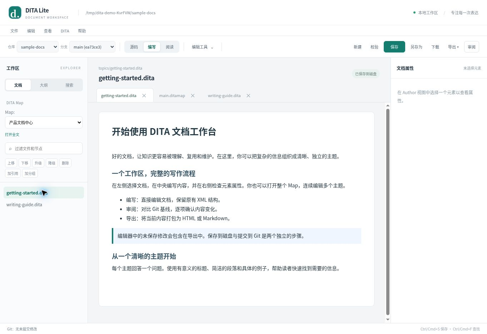
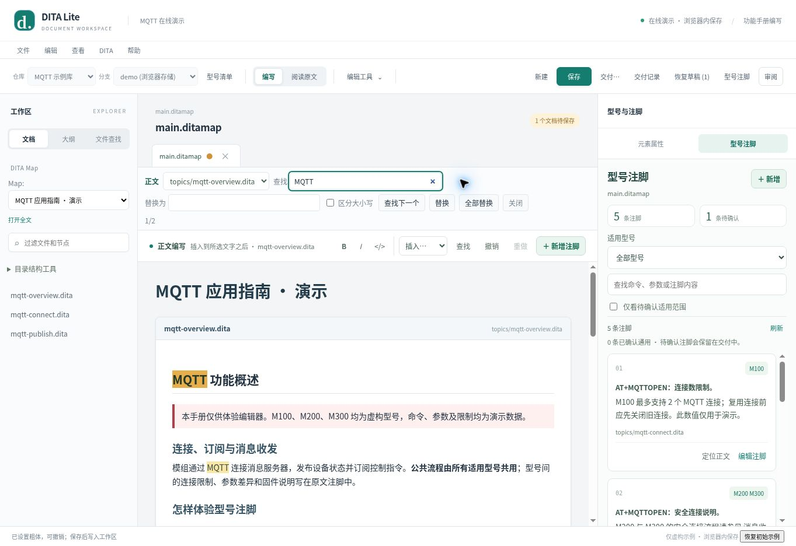
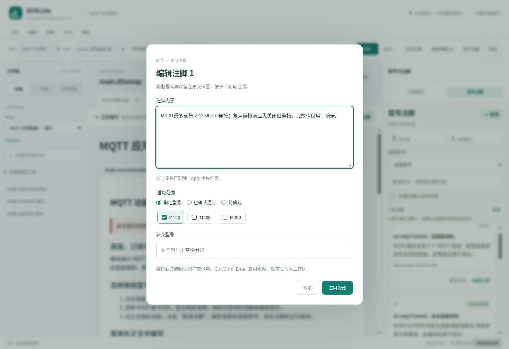
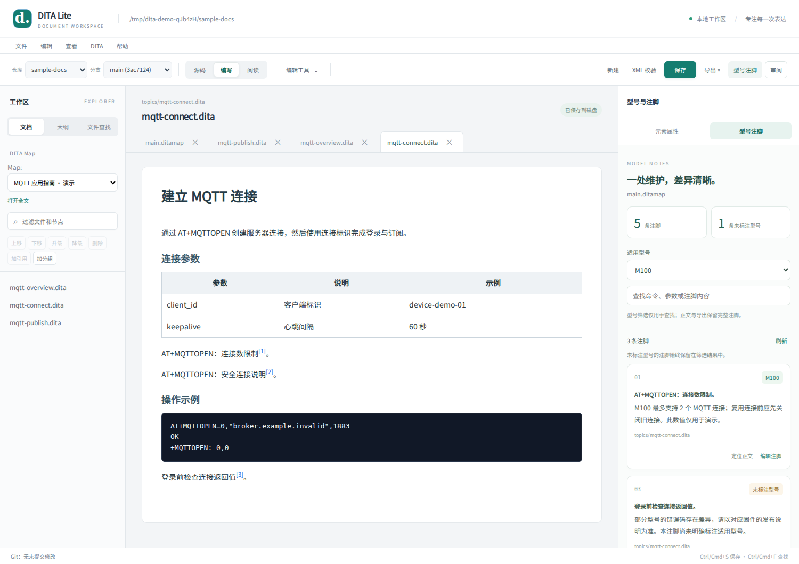

# DITA Lite Client

A lightweight local web client for reading, editing, reviewing, and exporting DITA documents.

## 中文操作入口

- [功能与操作说明](docs/authoring-guide.md)：从加载文档库、编写和注脚到保存、审阅、按型号交付；包含快捷键、失败处理和当前限制。
- [AI / 自动化操作约定](docs/assistant-playbook.md)：skill 风格的任务范围、操作选择、修改提案与复核约定，供后续 AI 接入复用。
- [功能走查记录](docs/functional-audit.md)：本轮核对范围、发现与修复、验证证据及待补能力。
- [AI 辅助写作](docs/ai-editing.md)：模型配置、粘贴问题定位、选区修订、审核与撤销。
- [AI 文字修订规则](docs/ai-writing-rules.md)：每轮默认发送给模型的执行与保留规则。
- [真实 HTTP 手册 AI 验收](docs/ai-acceptance.md)：13 项用例预检、已配置模型的实测和报告判读。
- [随 SDK 交付知识库计划](docs/knowledge-base-plan.md)：已记录的后续方向，暂缓实施。
- [企业交付模板设计](docs/enterprise-template-plan.md)：可替换模板包、动态字段、PDF/Word 适配和实施顺序；当前尚未接入导出。

## Writing workflow

- The compact top bar provides **编写 / 阅读 / 源码** modes and delivery. Repository/branch switches, model settings, drafts and delivery history live in the left navigation. XML-only tools remain beside the document's Save button.
- The right tool rail opens **属性 / 注脚 / 审阅** on demand. Drag the panel's left edge to resize it, or focus the separator and use arrow keys. On narrow screens, **文档** opens navigation. Document titles come from loaded XML; paths remain available for identification.
- Delivery groups **配置 / 检查 / 导出** around the same source snapshot. Changing model, format or version invalidates the previous check; preview and export always validate their source. The save indicator describes the current document scope, while dirty tabs retain their markers.
- **New** opens one form with function overview, AT command, parameter table, operation example, model difference and standard DITA templates. New files are create-only and can be added to a function manual through the Map tools.
- Select an element in Author mode to edit its **source attributes**, including cells inside a Map. Every change enters shared undo/redo and must be saved explicitly.
- Simple CALS tables support named columns, inserting/deleting rows and columns, header conversion and column widths (`1*`, `2*`, `30mm`). Delete table removes the complete table. Merged/irregular structures remain readable, with unsupported structure commands disabled.
- Paste text or basic rich HTML directly into Author mode. Paragraphs, emphasis, lists, links and rectangular tables are converted into DITA; images use the existing image tool. Complex tables fall back to plain text with a visible message. One paste is one undo action. Paragraph applicability is retained when a paste splits a conditioned paragraph.
- Search results and note locations navigate in the existing Map when possible. **Return to writing position** restores the preceding position; search results also offer explicit Source navigation.

## Quick Start

```bash
npm install
npm start          # starts on http://127.0.0.1:5050
npm test           # unit and HTTP workflow regression tests
npm run dev        # disposable sample workspace for trying the UI
```

Requires **Node.js 20+** and **Git**. `npm start` edits the repository configured by `DOCS_ROOT`; `npm run dev` uses temporary sample documents and deletes them when the demo stops.

## 界面外观

右侧工具栏 **外观**，或 **查看 → 界面外观**，可即时切换青绿、经典蓝、暖纸、深色，并支持跟随系统。偏好由当前浏览器保存；切换保持编写位置、未保存内容与撤销历史。HTML/PDF/Word 等客户文件保留固定交付版式，不随工作台皮肤变化。

## Development checks

Use Node **20.19+ / 22.13+ / 24+** for the pinned ESLint development tools. The application runtime remains Node 20+. Install the locked dependencies with `npm ci --ignore-scripts`, then run:

```bash
npm run lint          # first-party browser, server, scripts and tests; zero warnings
npm test              # unit and HTTP regression
npm run test:browser  # Chromium workflow regression
npm run check:ai      # real HTTP acceptance fixture preflight; no model call
```

ESLint checks recommended correctness rules, including undefined/unused variables and preserved error causes. Browser-evaluated test/PDF callbacks have explicit browser globals; vendored code and source manuals are excluded. Intentional control-character rejection has a local, explained rule exception. CI runs lint and `npm run typecheck` on Node 20 and 22 before unit tests. `.editorconfig` sets basic code/text conventions without changing DITA encoding or forcing a repository-wide format rewrite. Pinned TypeScript checks the actual document/proposal/save, manual capture/snapshot and delivery-record implementations through JSDoc and `public/data-contracts.d.ts`; no browser build step is required. UI/rendering modules remain incrementally typed.

## Remote document libraries

Run the local Node service with Git installed. In the left workspace settings, choose **加载远程库**, enter an HTTPS or SSH Git address and a new local name, optionally read/select a remote branch, then **克隆并选择手册**. Select an available `.ditamap` to begin writing. Libraries are stored under `REPOSITORIES_ROOT`; existing directories are never replaced. An empty/missing initial `DOCS_ROOT` can load the workbench so the first library can be imported.

**远程更新** first checks origin's tracked branch without changing working documents. **拉取更新** rechecks the exact local and remote commits and permits fast-forward only. Unsaved editor buffers, dirty/untracked Git files, local-ahead commits, divergent histories and changed remote checks block updating. Ignored files are also protected against checkout overwrite. A successful update rotates the workspace token, reloads files and reopens the active manual when it still exists.

Private repositories use existing Git credentials/SSH keys on the machine running the service. Configure credentials and host trust there first; the app never requests passwords or tokens. Addresses containing credentials, query parameters, file paths or Git helper protocols are refused. Git commands run without interactive prompts, with bounded timeouts and hooks/submodule recursion disabled. LFS objects and submodules are not downloaded automatically. Only the chosen branch is cloned; publishing/committing/pushing changes remains an external Git operation.

The static hosted demonstration has no filesystem Git backend. Its remote controls are explicitly disabled. The GitHub connector used to develop this project is separate from the application's repository credentials.

## Dependencies

- **iconv-lite** — used for GBK/GB2312/GB18030 encoding round-trip. DITA files
  with encoding="GBK" are read via TextDecoder and written back via
  iconv-lite.encode() so Chinese text is preserved on save. Without this
  dependency, GBK files would be silently converted to UTF-8 and corrupted.
- **docx** — generates editable Word paragraphs, tables, images and internal links in the browser. The server serves only the three fixed UMD entry points; no CDN is required.
- **playwright-core** — renders PDF with a local headless Chromium. Run `npx playwright-core install chromium` once, or set `DITA_CHROMIUM_EXECUTABLE` to an installed Chromium executable. On Linux install `fontconfig` and Chinese fonts, for example `sudo apt-get install fontconfig fonts-noto-cjk`. Run `npm run check:pdf` to verify Chromium and Chinese font readiness. Native Linux PDF generation checks coverage of the actual Han characters and stops with an actionable error if fonts are missing, rather than downloading a file with empty boxes.

The browser and server share a vendored copy of **sax 1.6.1** for XML validation. Its source, license and provenance are in `public/vendor/`. External DTDs/entities are not loaded.

## Key Features

- Author mode: visual editing with Oxygen tracked-change support, caret-based footnote creation and in-place note editing
- Reading mode: read-only Topic and Map surfaces sharing the Author renderer
- Review mode: Author content with a right-hand change dock and accept/reject per change block
- Map view: edit entire ditamap with all referenced topics
- HTML export: single-file HTML with embedded images, TOC, notes
- Markdown export: DITA to Markdown with syntax-highlighted preview
- PDF export: searchable text, print layout, repeated table headers and page numbers
- Word export: editable `.docx` with tables (including merged cells), embedded images and linked end-of-document notes
- Image path resolution: resolves relative hrefs against topic directory
- GBK encoding: preserves declared encoding on save
- Reliability: conflict-aware atomic saves, protected branch switching, stale-tab rejection
- Security: Origin validation, real-path containment, asset whitelist, streaming body limit
- Export includes current working buffers; local images are embedded in HTML and Markdown
- Map structure operations are undoable edits; use Save to write them to disk
- Manual saves show an explicit selection of changed Topics and referenced resources
- Recoverable browser drafts with repository/branch isolation and disk-base conflict checks
- Project model registry, explicit confirmed-common notes, and source editing for reused notes
- Cross-Topic plaintext search including unsaved buffers, plus image/Topic-link pickers
- Unified delivery preflight, version/model selection and downloadable provenance records

## PDF and Word delivery

Open a functional manual's Map (or an individual Topic), choose **交付功能手册**, select the model, document version and **PDF** or **Word（.docx）**, then check, preview or export. Every format uses the same captured working buffers, local references and model-note rules. Each functional manual remains a separate deliverable. Notes are collected at the end with shared numbering and repeat links, matching HTML.

Local PDF export downloads an actual `.pdf` and previews those same bytes. Word downloads a real Office Open XML `.docx`; its content preview uses HTML, and final pagination depends on Word and installed fonts. Text, headings and tables remain editable. SVG/WebP image assets alone are converted to PNG for Office compatibility. Unsupported conversions stop with a visible error instead of silently losing content. Word and PDF use Letter pages; corporate templates and page-size settings are not implemented.

The static online demonstration has no PDF rendering server. Its **PDF（打印另存）** option opens a content preview. Click **打印 / 另存 PDF** above the preview, then choose **另存为 PDF** and a destination in the browser dialog. That action cannot verify whether a file was saved and does not create a delivery record. Word still downloads directly in the demo. Other real downloads record a SHA-256 of the exact output bytes in browser-local delivery history.

## Configuration

| Env Var | Default | Description |
|---------|---------|-------------|
| PORT | 5050 | Server port |
| HOST | 127.0.0.1 | Bind address |
| PUBLIC_ORIGIN | unset | Trusted reverse-proxy origin, including its scheme and any non-default port |
| DOCS_ROOT | ../repo_ml353a | Default DITA repository root |
| REPOSITORIES_ROOT | parent of DOCS_ROOT | Allowed repo switching scope |




## Workflow and architecture

The light workspace separates document navigation, editing and the attribute/review panel. Frequent selection formatting, body search and block insertion stay beside the document. XML-oriented tools remain in the advanced dropdown; narrow screens use navigation and inspector drawers.

- `public/document-store.js`: shared document mutations, undo/redo, save coordination and edit proposals.
- `public/xml-source.js`: shared browser/server XML validation and source-preserving formatting.
- `public/review.js`: Git/Oxygen review controller, with explicit bulk-operation scope.
- `lib/xml-tree.js`: server XML tree parsing and serialization.
- `public/workspace-client.js`: workspace identity and stale-response handling.
- `public/export.js`: export snapshots, resource loading and preview/download orchestration.
- `public/publication-core.js`: shared source-preserving model-footnote filtering and reference validation for both publication formats.
- `public/publication-resolver.js`: bounded local dependency loading, common conref expansion and unsupported-feature checks.
- `public/app-core.js`: compatibility facade assembling Author, source, review and delivery APIs.
- `public/xml-dom.js` / `public/author-renderer.js` / `public/author-source.js`: validated XML/DOM adaptation, explicit-document Author projection and source-preserving writes from a detached surface.
- `public/oxygen-core.js`: document-local Oxygen presentation and source change enumeration.
- `public/app.js`: initial state and service assembly; the compatibility facade delegates to controllers.
- `public/app-dom.js`: DOM handle lookup, without behavior or IO.
- `public/workspace-controller.js`: workspace initialization, repository/branch changes and guarded directory refresh.
- `public/document-navigation.js`: document open/close and guarded source-position navigation.
- `public/workspace-view.js`: document header/status, tabs, outline, filename search and switch feedback.
- `public/app-actions.js` / `public/menu-controller.js`: toolbar/global commands and accessible menu interaction.
- `public/editor-controller.js`: shared document history, Source/Topic synchronization, mode changes and review coordination, with explicit service ports and view callbacks.
- `public/map-author-controller.js` / `public/map-source.js`: isolated Map loading/refresh lifecycle and source-preserving Map/Bookmap title edits; typing and title undo keep chapter surfaces mounted.
- `public/author-notes.js`: cancellable note insertion and direct marker editing, using the same source and history rules.
- `public/author-selection.js` / `public/editor-tools.js`: source-aware selections, bookmarks and detached edits; Author formatting, current-Topic plaintext search/replace, block/resource insertion and explicit Source tools.
- `public/input-history.js` / `public/note-scope.js`: input grouping/IME lifecycle and the shared model picker for new/existing notes.
- `public/delivery-core.js` / `public/delivery-document.js` / `public/markdown-preview.js`: DITA publication conversion, data-only HTML document layout and standalone Markdown preview/highlighting.
- `public/diff-core.js`: pure diff algorithms.
- `public/manual-core.js` / `public/manual-domain.js`: shared applicability/configuration, publication membership and pure snapshot-to-publication/note/model operations.
- `public/manual-service.js`: workspace reads, dependency capture and freshness checks; captures model settings before IO and exposes the same domain operations through the existing service interface.
- `public/save.js`, `drafts.js`, `project.js`, `search.js`, `resources.js`: independent feature controllers.
- `public/map-controller.js` / `public/documents.js`: directory and document lifecycle UI.
- `lib/workspace-tools.js`: authenticated project config, search, provenance and image routes.
- `lib/api-router.js` / `lib/http-utils.js`: common workspace/origin guard, API dispatch, bounded request decoding and response helpers.
- `lib/git-service.js`: repository/branch operations and encoded Git baselines, using the live workspace root.
- `lib/document-files.js`: encoding, real-path containment and atomic file writes.
- `lib/workspace-lock.js`: concurrent reads with exclusive saves/workspace switches.

Branch switching refuses a dirty Git worktree, including changes already saved by the editor. Commit or stash those changes with Git first. A failed save never intentionally replaces newer working text; download your working copy before reopening a file with a disk conflict.

The HTTP API validates Host before returning a workspace token, including GET requests that omit Origin, and requires the `workspaceToken` from `/api/workspace` in the `x-workspace-token` header for document operations. Updates also require `expectedContent`, the last-read disk content. This is a local single-workspace application, not a shared multi-user server. `PUBLIC_ORIGIN` explicitly allows a trusted reverse-proxy host and origin; binding `HOST=0.0.0.0` alone does not allow arbitrary hostnames. The disposable demonstration mode supports its preview proxy; default access remains localhost.

Author rendering keeps source event handlers, CSS and editor-reserved attributes as inert metadata; they are preserved in XML without becoming active HTML. Executable link schemes are disabled in Author and Markdown HTML rendering. Markdown URLs and code language names use attribute escaping, and generated HTML is not parsed again as Markdown.

See [architecture and extension boundaries](docs/architecture.md), [verification](docs/verification.md) and [AI authoring setup](docs/ai-editing.md). AI writing supports scoped text proposals through a server-configured compatible model endpoint, explicit review and shared undo. No provider/model is chosen by default; demo mode never connects to a model.

## Writing in Author mode

Select text inside one paragraph, title, list item or table cell, then use **B**, **I** or **</>** beside the document. Ctrl/Cmd+B and Ctrl/Cmd+I use the same operation; repeat to remove that format. Empty, cross-block and protected note/reuse/revision selections are refused. Removing a format retains existing identifiers and applicability attributes on a neutral `ph` over the original extent.

**查找** (Ctrl/Cmd+F) stays in Author or Reading mode and highlights rendered text, including matches spanning inline elements. It searches one explicitly selected Topic at a time; the selector makes Map scope visible. Attributes, footnote markers/content, reused content and revision marks are excluded. Replacement keeps existing inline elements/IDs, escapes XML and is one undo step per action. Reading allows search but disables replacement. A limit of 2,000 matches disables Replace All until the query is narrowed. In explicit Source mode, the same panel is labelled **XML 源码** and searches serialized XML instead.

Use **插入…** for paragraphs, lists, tables, sections, notes and code blocks. Selected text is retained; a new block follows the current block and its first placeholder is selected so you can immediately type. Paragraphs inside list items stay inside that item; tables inserted from a cell follow the enclosing table; new sections follow the containing body block. These structural choices avoid nesting blocks inside inline text. Save remains explicit, and current buffers participate in delivery before save.



## Continuous writing, notes and resources

Continuous text input and deletion are grouped by operation and caret continuity, with a 900 ms pause boundary. Moving the caret, changing modes, saving, undo/redo and explicit commands start a new group. One IME composition forms one undo group; cancelling it leaves no empty undo step. Source and Author input record before/after selections, including the target Topic in a Map. These and migrated visual operations restore their recorded writing positions; legacy review/structural commands retain their fallback behavior.

New and existing footnotes share the same **指定型号／已确认通用／待确认** picker. Registered model names are selectable chips; existing unknown names stay visible for repair. Without a registry, discovered names and a free-form supplement remain available. Inherited product conditions prevent confirming a note as universally common. Editing a local note from the Map list keeps the Map open. Shared notes still explicitly open their reference source, since that change affects every reference.

Choose **插入… → 图片／链接** from the writing toolbar, or use the advanced insertion picker. Images insert at the saved caret, or after selected text. Links use selected text while retaining inline attributes/IDs, or insert the chosen label at a collapsed caret. Both work inside a Map child without opening it separately. Cancel restores the selection; source/mode/workspace changes refuse stale insertion. Actual image uploads are create-only filesystem operations; applying the document reference and saving the document remain separate steps.



## Editing and review behavior

Reading is read-only. Git worktree changes and Oxygen tracked changes have separate bulk-action scopes. Both individual and bulk review actions remain in the editor until explicit Save; neither changes the committed Git comparison baseline. Undo/redo also restores review decisions. Save As and XML Download are available in the File menu.

XML validation is shared by browser and HTTP writes. It checks XML syntax, not full DITA DTD/schema conformance or cross-document references. Custom DTD entity expansion is not supported. Formatting only adjusts whitespace in known structural containers, preserving mixed text, code/pre content, xml:space, declarations, comments, processing instructions and declared encoding.

Run browser regression tests with `npx playwright-core install chromium` followed by `npm run test:browser`. `DITA_CHROMIUM_EXECUTABLE` optionally selects an installed Chromium binary. CI runs unit/API tests on Node 20/22 and browser tests on Node 22.

## Model footnotes

In **编写** mode, place the caret in a paragraph, list or table, then choose **＋ 新增注脚** (Ctrl/Cmd+Alt+N). Enter the note, explicitly choose its models, confirmed-common or unresolved scope, then click **插入注脚** (Ctrl/Cmd+Enter). A text selection is retained and the note is inserted after it. Continue typing after the marker; double-click a marker or focus it and press Enter to edit. Esc/cancel restores the writing position without changing the document. Undo/redo is visible beside the document; Save remains explicit. Map edits stay in the correct Topic without leaving the Map.


Click **型号注脚** while a Topic or function Map is open. The panel indexes actual `fn` elements, shows their surrounding command/context and supports model/keyword filtering, source navigation and editing. A Map scope stays selected while navigating to its individual Topics.

The ordinary footnote editor stores explicit model associations in each footnote's standard `product` attribute (space-separated model names). Existing prose is never used to infer support. Unlabelled footnotes remain visible under every panel filter. Publication also evaluates product conditions on Topic ancestors. Use **交付…** to select the publication model and format. To filter existing prose without editing DITA, use the independent rules below.

### 现有注脚只有型号文字时

对于 `ML307G/ML307N：说明` 这类原文格式，在交付设置选择型号后，显式勾选 **按“型号：说明”筛选注脚（请预览核对）**。程序按完整型号匹配，保留共用说明和当前型号对应片段，并将保留片段的共用型号标签缩成当前型号。支持分段、列表、嵌套块、行内加粗/参数标记，以及明确的“目前仅某型号支持”“某型号不支持”格式；型号前缀下的后续句子沿用该范围。不会把 BX-7 当作 BX-70 或 BX-7-MU。

这是一项需主动开启并预览核对的原文格式约定，不会批量确认或写入独立规则。已确认的独立规则优先。存在明确型号文字但未启用处理时，指定型号的检查/导出会要求先处理；含其他型号的复杂比较或不能确定范围的句子会转到 **核对注脚型号规则**，不会静默删除。全部型号交付保持原始内容，所有模式均不写回 DITA。

**正文条件过滤** 的 DITAVAL 是条件配置文件；例如 `exclude product=tbd` 表示排除产品标记为“待定（tbd）”的内容。列表显示文件中实际规则的中文摘要与原文件路径。它仅控制已有标记的正文、图片和注脚，不会从型号文字推断范围。型号文字筛选和所选条件文件共同生效，排除条件不能被前缀恢复。

### 不修改原始 DITA 的注脚交付规则

打开功能 Map，在 **注脚 → 导出型号规则（不改原文）** 中核对当前手册的来源注脚。也可以从单条注脚的 **导出型号规则** 按钮进入。系统按句子和完整 XML 结构展示片段；为每段选择 **所有型号通用** 或 **指定适用型号**，再预览目标型号并点击 **确认并保存规则**。型号可手动输入，多个型号用空格分隔。“填入型号建议”只识别已知型号的明确提及，仍需人工核对支持、不支持等语义；没有型号提及的片段不会自动确认为通用。

规则单独保存在文档库根目录的 `.dita-note-rules.json`，可以与文档一起通过 Git 管理。保存规则立即写入该配置，不修改 `.dita`、不改变当前编写内容，也不加入正文撤销历史。每个功能手册仍独立导出。规则按来源路径、节点位置、原注脚、周围正文及原有型号条件绑定；公共 `conref` 内容和重复注脚引用使用同一来源规则。换到其他来源的手册需要重新核对，其型号名称不受 HTTP 示例限制。

指定型号交付时，共用片段与该型号片段进入导出副本；整条注脚没有保留内容时，调用标记一并移除并连续重排编号。HTML、Markdown、PDF 和 Word 共用这一准备过程。**全部型号** 保留原始注脚；未配置规则的注脚沿用已有适用条件，未标注内容保留并提示待确认。规则只进一步筛选，不能覆盖 DITA 原有 `product` 或所选 DITAVAL 的排除条件。

原注脚、位置、周围正文或型号条件变化后，旧规则会标为过期，指定型号交付会要求重新核对。规则文件被外部修改时，保存会拒绝覆盖；已检查的导出也会要求重新打开交付设置。无效配置保留原文件并显示错误。可用 **移除这条规则** 恢复该注脚的原有交付行为。

独立规则保留加粗、斜体、链接、列表等原始 XML，默认不改写句子或共享型号标签；主动开启明确型号前缀处理时，可在导出副本中压缩匹配的标签。混在同一不可拆分行内元素或修订标记中的差异需要整段核对；保留片段中的其他型号名称不会自动删除。现有手册不会被批量自动确认。

Plain notes use a text editor with safe XML escaping; notes with inline markup use an XML-preserving editor. Updates retain identifiers, links, encoding declarations and surrounding source, use the shared undo history and require explicit Save. Outdated edits are refused. Reused footnotes offer **编辑引用源** and keep their including conditions visible. HTML exports include a linked footnote list with return links; Markdown includes complete numbered footnote definitions.

`npm run dev` opens an isolated copy of the Chinese HTTP/HTTPS manual in `examples/http_httpsusermanual`. Select `http_httpsusermanual.ditamap` to review the real command tables, responses and notes. Referenced shared topics, images and DITAVAL filters are included; editing the demo does not change the source manual. Use `npm run dev -- --docs /path/to/library --manual your-manual.ditamap` for another manual. Fictional MQTT content is retained only under `tests/fixtures/writing-demo` for regression tests.

### Publish a function manual for a model

Open the function's Map, then choose **交付…**. Select a model and HTML or Markdown, inspect the included/excluded/unlabelled counts, then preview or download. The current Map and Topic buffers are captured without saving or changing the source; changing an opened buffer invalidates the settings and requires reopening them. Each function Map remains a separate delivery. Existing ordinary exports include all models.

```xml
<p>Connection limit<fn product="M100">Up to two connections.</fn></p>
<p>Shared limit<fn product="M100 M200">Check the firmware release notes.</fn></p>
```

Model selection evaluates `product` on the footnote and its Topic ancestors. A note must match every applicable ancestor condition; a child cannot restore a note excluded by its parent. Without a DITAVAL, body content and notes without conditions are retained. Grouped product expressions and Map-level model selection still stop model export explicitly.

In **交付功能手册 → 正文条件过滤**, select a workspace `.ditaval` file to apply conditional processing to Map branches, Topic bodies, inline text, images and notes. For the real HTTP library, choose `filters/filter_tbd.ditaval` (or `filters/telecomversion.ditaval` for that delivery). This removes content marked only `product="tbd"`. No profile is selected automatically from filenames or Oxygen `.xpr` settings. The selected profile is remembered for that manual during the workspace session; choose **不使用 DITAVAL** to retain unfiltered body content.

Supported rules are `prop action="include|exclude|passthrough"` for `audience`, `platform`, `product`, `props`, `otherprops` and `deliveryTarget`, with attribute/global defaults and groups. Multiple values in one group use OR; groups and attributes use AND. Excluded ancestors exclude their contents. Flagging, revision flags, custom profiling specializations and branch `ditavalref` are not implemented and fail explicitly. The same captured profile applies to check, preview and all export formats; changing an opened profile buffer invalidates the delivery. Delivery records include its path and SHA-256, alongside the source document hashes. Filtering never writes back to the source library.

An `fn` with an `id` is a reusable definition. Reference it with `xref type="fn"`; unreferenced definitions are omitted, repeated references share one number, and HTML callouts link to one footnote entry and back. The following example demonstrates repeated references:

```xml
<p>First mention<xref href="#topic-id/note-id" type="fn"/>.</p>
<p>Second mention<xref href="#topic-id/note-id" type="fn"/>.</p>
<fn id="note-id" product="M100">Model-specific detail.</fn>
```

Footnote references may target another local workspace file, including a resource file outside the published Map. Repeated references share one definition and number across chapters. Local same-element `conref` chains are expanded in the publication copy, keeping local attributes/IDs and rebasing relative image paths. Dependency reads include current unsaved buffers and participate in stale-snapshot checks. Resource-only Map references supply reusable content without adding chapters. HTML and Markdown use the same prepared publication snapshot and filtering rules.

Local DITA links are rewritten to explicit document anchors. Missing targets stop export. CALS column/row spans are retained in HTML; Markdown rejects merged cells explicitly instead of flattening them into misleading columns. Simple tables and footnotes in tables/lists use the same publication context. See [compatibility verification and supported boundaries](docs/publication-compatibility.md).



## Workspace foundation

Use **型号清单** to maintain allowed names in the current repository's optional `.dita-project.json`. Choose **已确认通用** to confirm a universally applicable note, or **待确认** for unresolved applicability; unresolved notes remain in delivery. The standard metadata marker `otherprops="applicability(common)"` records confirmation without turning an inline note into an ID-bearing definition.

Saving a Map lists dirty files in its direct local dependency scope. Select the files to persist; unrelated and unselected edits stay in the workspace. Multi-file saves remain non-transactional and report partial failures. Draft recovery preserves the exact disk base, is isolated by repository and branch, and never overwrites a changed disk file automatically. Drafts and delivery records live in the current browser.

The sidebar offers repository/manual plaintext search with exact source navigation; current dirty buffers override disk hits. Insert **image** or **xref** through the resource picker to choose files/sections and generate relative paths. Uploaded images are create-only and limited to 2 MiB.

**交付…** combines model/format/version selection, issue navigation, image/link preflight and preview/download. Cancel stops pending delivery. Downloads are announced as initiated; use browser download history to find them. **交付记录** stores up to 50 local provenance records per repository and can download their JSON for separate archiving. XML source/draft downloads normalize their declarations to the browser's UTF-8 bytes; encoded filesystem saves continue to preserve the declared encoding.

## Architecture maintenance

Feature startup is declared in `public/application.js`, including factories, dependency ports, initialization requirements and compatibility APIs. Delivery is an explicitly constructed controller; it no longer initializes through script-load side effects. New document state and save/manual snapshots use the shared `document-store` constructors. Protected workspace fields and document membership use named operations in `public/workspace-session.js`; captured Maps expose read-only views. Checked data contracts are in `public/data-contracts.d.ts`, while `public/contracts.js` documents the remaining UI ports; current runtime checks and dependency constraints are described in [architecture](docs/architecture.md).

## 日常编写

同一功能手册的注脚按首次引用顺序连续编号，Map 全文、单独打开的手册章节、右侧列表和编辑窗口使用同一编号。重复的 `xref type="fn"` 共用编号，定义位置显示“定义 N”；未引用的命名定义不占编号。列表按型号或关键词过滤时保留手册编号，按型号交付时再对实际保留的注脚连续编号。不同手册以及不属于当前手册的独立 Topic 分别编号；显式 `callout` 保留原标记。

新增、删除、撤销或重做注脚后，后续章节的显示编号会更新，不写回 XML，也不会为编号变化增加撤销记录。引用有误时显示待确认编号并给出读取错误，避免沿用看似有效的旧编号；注脚修改仍按源文件和 XML 节点定位。

左侧文档导航默认宽度为 296px，可拖动右边界调整，双击恢复默认；边界获得焦点后也可使用方向键、Home / End。宽度记在当前浏览器中，小窗口会临时收窄，放大后恢复偏好。仓库与分支各用完整一行，长目录标题和大纲可换行，过滤无结果时会显示提示。

查找和目录区域可以独立滚动，短屏幕仍可访问底部文档库操作。小于等于 1280px 的窗口使用浮动辅助面板，避免继续压缩正文；手机导航提供关闭按钮、遮罩与键盘焦点循环，关闭后可返回“文档”按钮。

文档加载现在按工作区和文件合并请求，Map 与单文档共用同一缓冲区；快速切换时保留最后一次打开意图。另存为会在覆盖前再次核对目标编辑区，写入返回后保留等待期间新增的文字和撤销记录。切换手册会清除目录节点选择，过期的目录操作不会作用到另一份手册。

子目录 Map 的新增引用按当前 Map 所在目录输入。跨目录另存为会调整图片、内部链接、`conref` 等相对引用，保留 XML 声明、编码、注释和正文；Map 副本会立即加入手册列表。包含非空 `xml:base` 的跨目录复制会明确停止，避免生成引用基准不明确的副本。

右侧“设置”打开“内容设置”：点击正文即可显示当前段落、表格、图片、链接或说明的常用操作。表格行列、表头和列宽直接可见；图片和链接使用统一编辑窗口，说明类型使用中文选项。新增段落和结构转换统一使用顶部“插入…”和“转换…”。

原始 XML 字段和“添加属性”集中在默认收起的“高级属性”中。连续编辑同一内容时保留展开状态，选中其他内容后恢复收起；修改仍可撤销，保存后写入文件。型号注脚的内容与型号通过注脚面板维护，已有父级型号条件只作提示，不代表整段正文按型号隐藏。

- 标题内按 Enter 保留完整标题，并进入正文。正文 Enter / Shift+Enter 新建段落；空列表项 Enter 退出列表。代码块 Enter 使用真实换行并沿用本行缩进。
- 列表 Tab / Shift+Tab 调整层级；代码块 Tab 插入四个空格，选中多行后可整体缩进或反缩进。按 Esc 后再按 Tab 可离开编辑区。
- 表格插入窗口可设置正文行数、列数和表头。表格内 Tab / Shift+Tab 切换单元格；最后一个单元格 Tab 新增正文行。合并或不规则表格继续保留原结构，结构编辑仍使用源码。
- 工具栏“转换…”可将当前段落改为列表、说明、提示、警告或代码块。连续正文段落可一起转为列表；嵌套复杂结构和带注脚的纯文本转换会给出具体提示。
- 相同适用条件的连续正文段落支持跨段落粘贴、输入替换和删除，保留未选中的前后文字；不同条件、注脚、引用和修订内容会阻止跨范围替换。退格合并段落也检查属性。
- 双击已有图片或链接，或在元素工具中选择“编辑图片／编辑链接”，可原位修改。图片支持替换、说明和尺寸；链接支持地址、文字及手册内目标。修改保留其他属性、图片子元素和已有行内锚点，可撤销；点击保存后才写入文件。

这些操作复用同一文档历史，在 Map 编写中仅修改当前 Topic。跨段落操作目前限同一容器中的连续普通段落；表格、列表与复杂 DITA 结构之间的跨范围替换仍需分别编辑。尺寸预览和 HTML 保留有效尺寸值，Markdown 使用标准图片语法。


### 正文快捷工具与注脚详情

在普通正文、列表或表格文字中放置光标或选中文字，按 `Alt+Z` 唤出快捷工具，可就近插入注脚、链接、表格或图片；选中文字后还可加粗、斜体和设置行内代码。鼠标点击、选中文字和方向键移动光标均不会自动弹出工具。方向键选择操作，`Esc` 或再次按 `Alt+Z` 返回原选区。输入文字、输入法组字、滚动或切换文档时收起工具，保护注脚、引用与修订内容的边界。

单击注脚标记查看内容、适用型号条件、来源和当前手册内使用次数；双击或 Enter 仍直接编辑。公共源的使用位置按当前功能手册统计，包含直接注脚引用与整块内容复用，不代表整个文档库。公共源已在当前全文中显示时就地编辑，应用或取消后恢复原选区；需要打开源文件时保留“返回编写位置”入口。型号选择下方实时显示与上级条件的交集，无交集时提示；待确认内容仍遵循现有交付规则。

“帮助 → 快捷键”打开可滚动的快捷键说明窗口，列出实际支持的编辑、正文和注脚操作；Esc 或关闭按钮收起帮助。


### 按位置显示的浮标操作

在正文中按 `Alt+Z` 唤出浮标。普通正文可在后方插入段落，“更多”可转为无序／有序列表、说明或代码块，以及插入表格、图片。表格单元格显示下方插行、右侧插列及表头切换；合并／不规则表格会禁用不支持的操作并说明原因。

选中文字可清除粗体、斜体与行内代码，保留链接、锚点和型号条件，未选中文字的格式保持不变。光标在普通链接内时，可编辑链接或取消整个链接；取消链接保留文字、行内格式、ID 和型号条件。

“引用已有注脚”从当前功能手册及其显式公共资源中选择带 ID 的注脚定义，支持按内容、来源和型号搜索，并显示公共源及当前位置的适用条件。插入的是 `xref type="fn"`，不复制或修改公共源；无 ID 的行内注脚、引用别处的定义及使用 xml:base 的定义不列入。当前手册之外的仓库不会自动扫描。按型号交付时，引用位置和公共源的型号条件共同生效。所有操作使用现有撤销历史，保存仍需显式执行。
