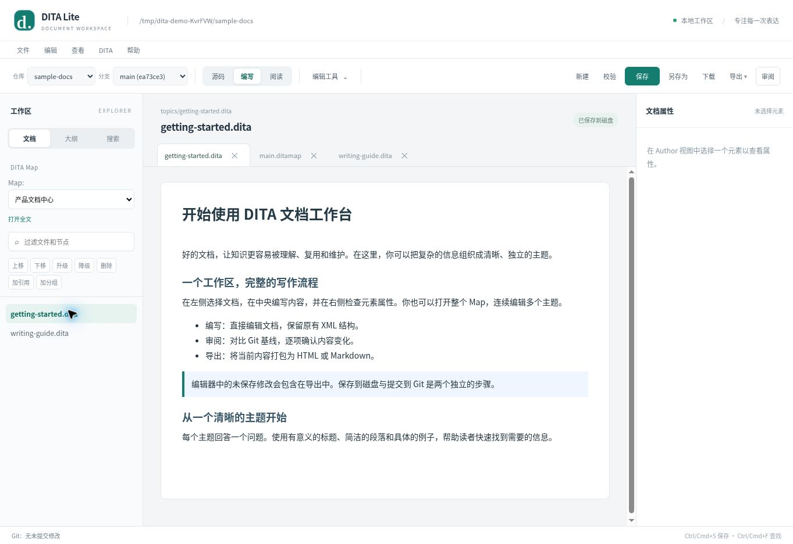
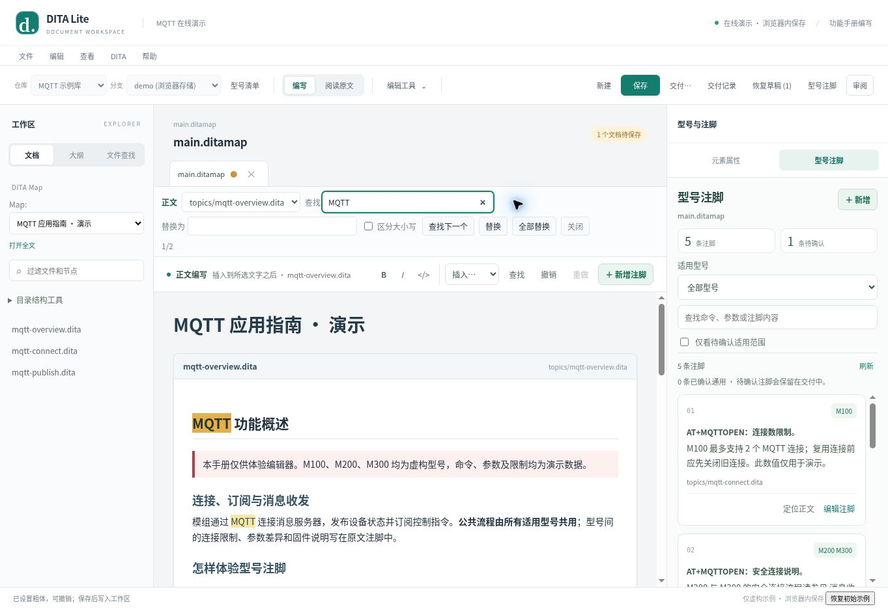
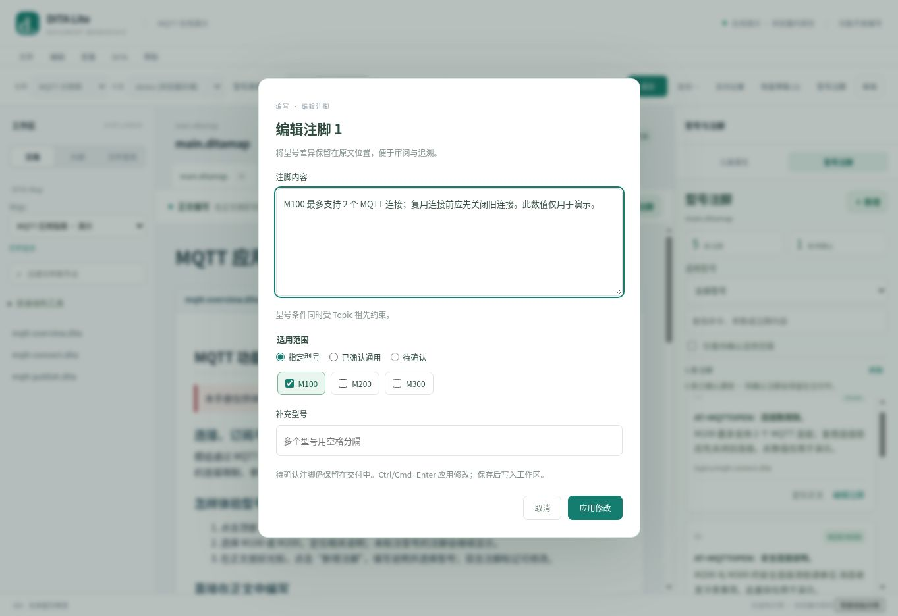
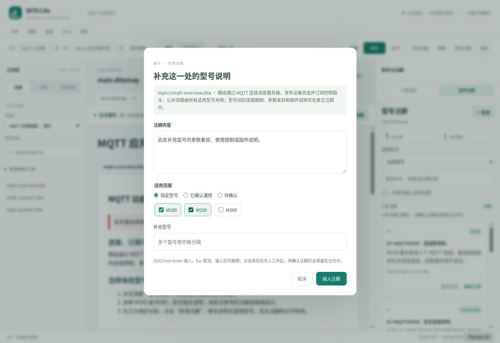
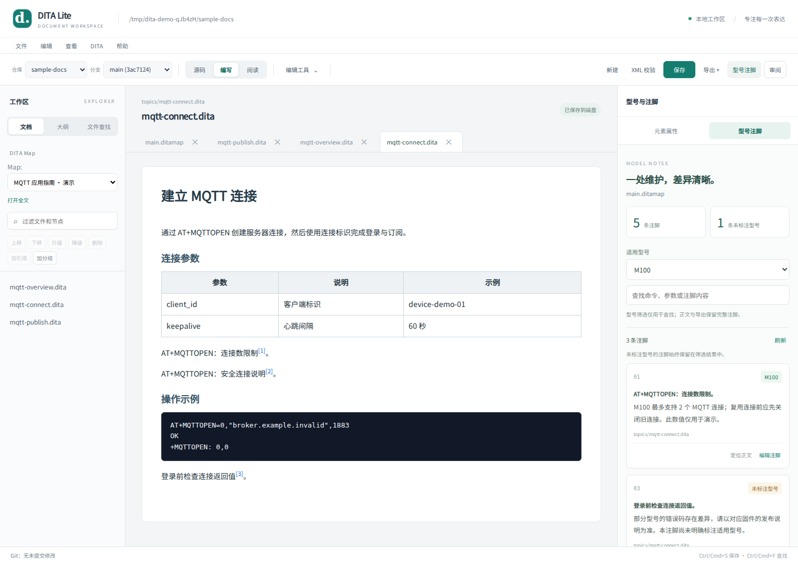

# DITA Lite Client

A lightweight local web client for reading, editing, reviewing, and exporting DITA documents.

## Quick Start

```bash
npm install
npm start          # starts on http://127.0.0.1:5050
npm test           # unit and HTTP workflow regression tests
npm run dev        # disposable sample workspace for trying the UI
```

Requires **Node.js 20+** and **Git**. `npm start` edits the repository configured by `DOCS_ROOT`; `npm run dev` uses temporary sample documents and deletes them when the demo stops.

## Dependencies

- **iconv-lite** — used for GBK/GB2312/GB18030 encoding round-trip. DITA files
  with encoding="GBK" are read via TextDecoder and written back via
  iconv-lite.encode() so Chinese text is preserved on save. Without this
  dependency, GBK files would be silently converted to UTF-8 and corrupted.
- **docx** — generates editable Word paragraphs, tables, images and internal links in the browser. The server serves only the three fixed UMD entry points; no CDN is required.
- **playwright-core** — renders PDF with a local headless Chromium. Run `npx playwright-core install chromium` once, or set `DITA_CHROMIUM_EXECUTABLE` to an installed Chromium executable. On Linux install Chinese fonts, for example `fonts-noto-cjk`, to render Chinese correctly.

The browser and server share a vendored copy of **sax 1.6.1** for XML validation. Its source, license and provenance are in `public/vendor/`. External DTDs/entities are not loaded.

## Key Features

- Author mode: visual editing with Oxygen tracked-change support, caret-based footnote creation and in-place note editing
- Reading mode: read-only Topic and Map surfaces sharing the Author renderer
- Review mode: side-by-side diff with accept/reject per change block
- Map view: edit entire ditamap with all referenced topics
- HTML export: single-file HTML with embedded images, TOC, notes
- Markdown export: DITA to Markdown with syntax-highlighted preview
- PDF export: searchable text, print layout, repeated table headers and page numbers
- Word export: editable `.docx` with tables (including merged cells), embedded images and linked end-of-document notes
- Image path resolution: resolves relative hrefs against topic directory
- GBK encoding: preserves declared encoding on save
- Reliability: conflict-aware atomic saves, protected branch switching, stale-tab rejection
- Security: Origin validation, real-path containment, asset whitelist, streaming body limit
- Export includes current working buffers; local images are embedded in HTML and Markdown
- Map structure operations are undoable edits; use Save to write them to disk
- Manual saves show an explicit selection of changed Topics and referenced resources
- Recoverable browser drafts with repository/branch isolation and disk-base conflict checks
- Project model registry, explicit confirmed-common notes, and source editing for reused notes
- Cross-Topic plaintext search including unsaved buffers, plus image/Topic-link pickers
- Unified delivery preflight, version/model selection and downloadable provenance records

## PDF and Word delivery

Open a functional manual's Map (or an individual Topic), choose **交付功能手册**, select the model, document version and **PDF** or **Word（.docx）**, then check, preview or export. Every format uses the same captured working buffers, local references and model-note rules. Each functional manual remains a separate deliverable. Notes are collected at the end with shared numbering and repeat links, matching HTML.

Local PDF export downloads an actual `.pdf` and previews those same bytes. Word downloads a real Office Open XML `.docx`; its content preview uses HTML, and final pagination depends on Word and installed fonts. Text, headings and tables remain editable. SVG/WebP image assets alone are converted to PNG for Office compatibility. Unsupported conversions stop with a visible error instead of silently losing content. Word and PDF use Letter pages; corporate templates and page-size settings are not implemented.

The static online demonstration has no PDF rendering server. Its **PDF（打印另存）** option opens a content preview. Click **打印 / 另存 PDF** above the preview, then choose **另存为 PDF** and a destination in the browser dialog. That action cannot verify whether a file was saved and does not create a delivery record. Word still downloads directly in the demo. Other real downloads record a SHA-256 of the exact output bytes in browser-local delivery history.

## Configuration

| Env Var | Default | Description |
|---------|---------|-------------|
| PORT | 5050 | Server port |
| HOST | 127.0.0.1 | Bind address |
| DOCS_ROOT | ../repo_ml353a | Default DITA repository root |
| REPOSITORIES_ROOT | parent of DOCS_ROOT | Allowed repo switching scope |




## Workflow and architecture

The light workspace separates document navigation, editing and the attribute/review panel. Frequent selection formatting, body search and block insertion stay beside the document. XML-oriented tools remain in the advanced dropdown; narrow screens use navigation and inspector drawers.

- `public/document-store.js`: shared document mutations, undo/redo, save coordination and edit proposals.
- `public/xml-source.js`: shared browser/server XML validation and source-preserving formatting.
- `public/review.js`: Git/Oxygen review controller, with explicit bulk-operation scope.
- `lib/xml-tree.js`: server XML tree parsing and serialization.
- `public/workspace-client.js`: workspace identity and stale-response handling.
- `public/export.js`: export snapshots, resource loading and preview/download orchestration.
- `public/publication-core.js`: shared source-preserving model-footnote filtering and reference validation for both publication formats.
- `public/publication-resolver.js`: bounded local dependency loading, common conref expansion and unsupported-feature checks.
- `public/app-core.js`: source-preserving Author rendering/conversion.
- `public/editor-controller.js`: Source/Topic/Map synchronization, document history, mode changes and review coordination, with injected view callbacks.
- `public/author-notes.js`: cancellable note insertion and direct marker editing, using the same source and history rules.
- `public/author-selection.js` / `public/editor-tools.js`: source-aware selections, bookmarks and detached edits; Author formatting, current-Topic plaintext search/replace, block/resource insertion and explicit Source tools.
- `public/input-history.js` / `public/note-scope.js`: input grouping/IME lifecycle and the shared model picker for new/existing notes.
- `public/delivery-core.js` / `public/diff-core.js`: publication rendering and pure diff algorithms.
- `public/manual-core.js` / `public/manual-service.js`: shared applicability/configuration and immutable manual dependency snapshots.
- `public/save.js`, `drafts.js`, `project.js`, `search.js`, `resources.js`: independent feature controllers.
- `public/map-controller.js` / `public/documents.js`: directory and document lifecycle UI.
- `lib/workspace-tools.js`: authenticated project config, search, provenance and image routes.
- `lib/api-router.js` / `lib/http-utils.js`: common workspace/origin guard, API dispatch, bounded request decoding and response helpers.
- `lib/git-service.js`: repository/branch operations and encoded Git baselines, using the live workspace root.
- `lib/document-files.js`: encoding, real-path containment and atomic file writes.
- `lib/workspace-lock.js`: concurrent reads with exclusive saves/workspace switches.

Branch switching refuses a dirty Git worktree, including changes already saved by the editor. Commit or stash those changes with Git first. A failed save never intentionally replaces newer working text; download your working copy before reopening a file with a disk conflict.

The HTTP API requires the `workspaceToken` returned by `/api/workspace` in the `x-workspace-token` header for document operations. Updates also require `expectedContent`, the last-read disk content. This is a local single-workspace application, not a shared multi-user server. `PUBLIC_ORIGIN` can explicitly allow a trusted reverse-proxy origin; default access remains localhost.

See [architecture and extension boundaries](docs/architecture.md), [verification](docs/verification.md) and the [AI authoring integration plan](docs/ai-editing.md). AI proposal primitives are implemented; no AI provider or generation UI is connected yet.

## Writing in Author mode

Select text inside one paragraph, title, list item or table cell, then use **B**, **I** or **</>** beside the document. Ctrl/Cmd+B and Ctrl/Cmd+I use the same operation; repeat to remove that format. Empty, cross-block and protected note/reuse/revision selections are refused. Removing a format retains existing identifiers and applicability attributes on a neutral `ph` over the original extent.

**查找** (Ctrl/Cmd+F) stays in Author or Reading mode and highlights rendered text, including matches spanning inline elements. It searches one explicitly selected Topic at a time; the selector makes Map scope visible. Attributes, footnote markers/content, reused content and revision marks are excluded. Replacement keeps existing inline elements/IDs, escapes XML and is one undo step per action. Reading allows search but disables replacement. A limit of 2,000 matches disables Replace All until the query is narrowed. In explicit Source mode, the same panel is labelled **XML 源码** and searches serialized XML instead.

Use **插入…** for paragraphs, lists, tables, sections, notes and code blocks. Selected text is retained; a new block follows the current block and its first placeholder is selected so you can immediately type. Paragraphs inside list items stay inside that item; tables inserted from a cell follow the enclosing table; new sections follow the containing body block. These structural choices avoid nesting blocks inside inline text. Save remains explicit, and current buffers participate in delivery before save.



## Continuous writing, notes and resources

Continuous text input and deletion are grouped by operation and caret continuity, with a 900 ms pause boundary. Moving the caret, changing modes, saving, undo/redo and explicit commands start a new group. One IME composition forms one undo group; cancelling it leaves no empty undo step. Source and Author input record before/after selections, including the target Topic in a Map. These and migrated visual operations restore their recorded writing positions; legacy review/structural commands retain their fallback behavior.

New and existing footnotes share the same **指定型号／已确认通用／待确认** picker. Registered model names are selectable chips; existing unknown names stay visible for repair. Without a registry, discovered names and a free-form supplement remain available. Inherited product conditions prevent confirming a note as universally common. Editing a local note from the Map list keeps the Map open. Shared notes still explicitly open their reference source, since that change affects every reference.

Choose **插入… → 图片／链接** from the writing toolbar, or use the advanced insertion picker. Images insert at the saved caret, or after selected text. Links use selected text while retaining inline attributes/IDs, or insert the chosen label at a collapsed caret. Both work inside a Map child without opening it separately. Cancel restores the selection; source/mode/workspace changes refuse stale insertion. Actual image uploads are create-only filesystem operations; applying the document reference and saving the document remain separate steps.



## Editing and review behavior

Reading is read-only. Git worktree changes and Oxygen tracked changes have separate bulk-action scopes. Both individual and bulk review actions remain in the editor until explicit Save; neither changes the committed Git comparison baseline. Undo/redo also restores review decisions. Save As and XML Download are available in the File menu.

XML validation is shared by browser and HTTP writes. It checks XML syntax, not full DITA DTD/schema conformance or cross-document references. Custom DTD entity expansion is not supported. Formatting only adjusts whitespace in known structural containers, preserving mixed text, code/pre content, xml:space, declarations, comments, processing instructions and declared encoding.

Run browser regression tests with `npx playwright-core install chromium` followed by `npm run test:browser`. `DITA_CHROMIUM_EXECUTABLE` optionally selects an installed Chromium binary. CI runs unit/API tests on Node 20/22 and browser tests on Node 22.

## Model footnotes

In **编写** mode, place the caret in a paragraph, list or table, then choose **＋ 新增注脚** (Ctrl/Cmd+Alt+N). Enter the note, explicitly choose its models, confirmed-common or unresolved scope, then click **插入注脚** (Ctrl/Cmd+Enter). A text selection is retained and the note is inserted after it. Continue typing after the marker; double-click a marker or focus it and press Enter to edit. Esc/cancel restores the writing position without changing the document. Undo/redo is visible beside the document; Save remains explicit. Map edits stay in the correct Topic without leaving the Map.



Click **型号注脚** while a Topic or function Map is open. The panel indexes actual `fn` elements, shows their surrounding command/context and supports model/keyword filtering, source navigation and editing. A Map scope stays selected while navigating to its individual Topics.

Explicit model associations are stored in each footnote's standard `product` attribute (space-separated model names). Existing prose is never used to infer support. Unlabelled footnotes remain visible under every panel filter. Publication also evaluates product conditions on Topic ancestors. The panel and delivery use the same applicability and dependency rules. Use **交付…** to select the publication model and format.

Plain notes use a text editor with safe XML escaping; notes with inline markup use an XML-preserving editor. Updates retain identifiers, links, encoding declarations and surrounding source, use the shared undo history and require explicit Save. Outdated edits are refused. Reused footnotes offer **编辑引用源** and keep their including conditions visible. HTML exports include a linked footnote list with return links; Markdown includes complete numbered footnote definitions.

`npm run dev` opens an isolated MQTT demonstration with fictional M100/M200/M300 models. Open `main.ditamap`, click **型号注脚**, choose M100 and try editing or locating a note. All product limits/commands in this demo are illustrative.

### Publish a function manual for a model

Open the function's Map, then choose **交付…**. Select a model and HTML or Markdown, inspect the included/excluded/unlabelled counts, then preview or download. The current Map and Topic buffers are captured without saving or changing the source; changing an opened buffer invalidates the settings and requires reopening them. Each function Map remains a separate delivery. Existing ordinary exports include all models.

```xml
<p>Connection limit<fn product="M100">Up to two connections.</fn></p>
<p>Shared limit<fn product="M100 M200">Check the firmware release notes.</fn></p>
```

Publication evaluates `product` on the footnote and its Topic ancestors. A note must match every applicable ancestor condition; a child cannot restore a note excluded by its parent. Notes with no conditions are retained, and body content is retained. This is footnote-scoped publication, not a complete DITA conditional-processing pipeline. Grouped product expressions and Map-level profiling stop model export explicitly.

An `fn` with an `id` is a reusable definition. Reference it with `xref type="fn"`; unreferenced definitions are omitted, repeated references share one number, and HTML callouts link to one footnote entry and back. The MQTT publishing sample demonstrates repeated references:

```xml
<p>First mention<xref href="#topic-id/note-id" type="fn"/>.</p>
<p>Second mention<xref href="#topic-id/note-id" type="fn"/>.</p>
<fn id="note-id" product="M100">Model-specific detail.</fn>
```

Footnote references may target another local workspace file, including a resource file outside the published Map. Repeated references share one definition and number across chapters. Local same-element `conref` chains are expanded in the publication copy, keeping local attributes/IDs and rebasing relative image paths. Dependency reads include current unsaved buffers and participate in stale-snapshot checks. Resource-only Map references supply reusable content without adding chapters. HTML and Markdown use the same prepared publication snapshot and filtering rules.

Local DITA links are rewritten to explicit document anchors. Missing targets stop export. CALS column/row spans are retained in HTML; Markdown rejects merged cells explicitly instead of flattening them into misleading columns. Simple tables and footnotes in tables/lists use the same publication context. See [compatibility verification and supported boundaries](docs/publication-compatibility.md).



## Workspace foundation

Use **型号清单** to maintain allowed names in the current repository's optional `.dita-project.json`. Choose **已确认通用** to confirm a universally applicable note, or **待确认** for unresolved applicability; unresolved notes remain in delivery. The standard metadata marker `otherprops="applicability(common)"` records confirmation without turning an inline note into an ID-bearing definition.

Saving a Map lists dirty files in its direct local dependency scope. Select the files to persist; unrelated and unselected edits stay in the workspace. Multi-file saves remain non-transactional and report partial failures. Draft recovery preserves the exact disk base, is isolated by repository and branch, and never overwrites a changed disk file automatically. Drafts and delivery records live in the current browser.

The sidebar offers repository/manual plaintext search with exact source navigation; current dirty buffers override disk hits. Insert **image** or **xref** through the resource picker to choose files/sections and generate relative paths. Uploaded images are create-only and limited to 2 MiB.

**交付…** combines model/format/version selection, issue navigation, image/link preflight and preview/download. Cancel stops pending delivery. Downloads are announced as initiated; use browser download history to find them. **交付记录** stores up to 50 local provenance records per repository and can download their JSON for separate archiving. XML source/draft downloads normalize their declarations to the browser's UTF-8 bytes; encoded filesystem saves continue to preserve the declared encoding.
